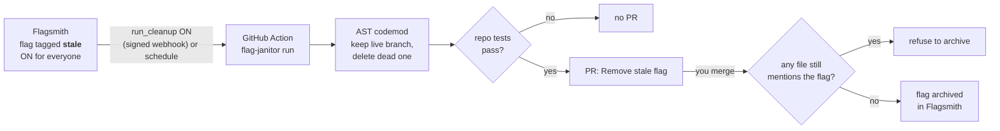

# Flag Janitor

[](https://github.com/mohammedsharukhh/flag-janitor/actions/workflows/test.yml)


▶️ **[Demo video (3:49)](https://youtu.be/XlObxPB2uiw)**

Feature flags are easy to add and nobody removes them. Flagsmith already tells you a flag is **stale**.
Flag Janitor does the boring part: it **deletes the flag from your code**, runs your tests, opens a PR,
and once that PR merges it **archives the flag in Flagsmith**.



**Toggle Wars, Track 03 (Build on Open Source Flagsmith):** an integration and developer tool for **self-hosted Flagsmith**.
Everything talks to your own Flagsmith instance (Docker Compose included), and it plugs into any repo as a GitHub Action.
See it working: [demo-shop pull requests](https://github.com/mohammedsharukhh/flag-janitor-demo-shop/pulls) opened by the janitor.

## Try it in 5 minutes

```bash
git clone https://github.com/mohammedsharukhh/flag-janitor && cd flag-janitor && npm install
docker compose -f flagsmith/docker-compose.yml up -d     # self-hosted Flagsmith on http://localhost:8000
```

1. In Flagsmith, create a project, tag one flag `stale`, and create an **Admin API key** (Organisation settings → API Keys).
2. Point the janitor at it and at any JS/TS repo that uses that flag:

```bash
export FLAGSMITH_API_URL=http://localhost:8000/api/v1
export FLAGSMITH_API_KEY=...        # admin key
export FLAGSMITH_ENVIRONMENT=...    # Production environment key
node src/cli.js scan --dir ../your-app             # which stale flags, which files
node src/cli.js run --dry-run --dir ../your-app    # the exact diffs, nothing written
```

Happy with the diff? Drop `--dry-run` (it opens one PR per flag via `gh`), or add the [GitHub Action](#github-action).

## What the rewrite looks like

```diff
-  if (flags.isFeatureEnabled('new_checkout')) {
-    return subtotal >= 50 ? subtotal : subtotal + 5;
-  } else {
-    return subtotal + 7;
-  }
+  return subtotal >= 50 ? subtotal : subtotal + 5;

-  const useNewCheckout = flags.isFeatureEnabled('new_checkout');
-  return useNewCheckout ? 'Pay now' : 'Proceed to checkout';
+  return 'Pay now';

-      {flagsmith.hasFeature('holiday_banner') && <HolidayBanner />}
```

**Tested on real code:** 240 flag removals (each flag ON and OFF) across 75 files from 5 open-source repos, including
Flagsmith's own frontend and salesforce/refocus: 0 crashes, 0 invalid output.

It is a real AST codemod (jscodeshift), not find-and-replace. It handles `if/else`, `else if`, `!`, `&&`, `||`,
ternaries, `await`, `const x = hasFeature(...)` and JSX children, for JS, TS, JSX and TSX.

## How it uses Flagsmith

| Flagsmith piece | Used for |
|---|---|
| **Stale tag** (system tag or a `stale` tag) | which flags to remove |
| **Production environment state** | whether to keep the ON or the OFF branch |
| **Segment / identity overrides, multivariate** | safety: a flag that isn't one value for everyone is skipped |
| **Admin API, archive** | archive the flag after the cleanup PR merges |
| **@flagsmith/nodejs SDK, its own flags** | dogfooding: `open_prs` and `archive_flags` flags switch the janitor's own risky actions on/off |
| **Signed webhooks** | flip the `run_cleanup` flag ON in Flagsmith and the cleanup workflow starts; the flag switches itself back off |

Turn `open_prs` off in Flagsmith and the janitor only prints diffs. No redeploy, no config change.

## Safety rules

- Skips flags with segment overrides, identity overrides or multiple variants.
- Never opens a PR if your tests fail.
- Never archives a flag while any code still mentions it (catches `getValue('x')`, config, anything the codemod didn't rewrite).
- Refuses to run on a dirty git tree. One PR per flag; won't open a duplicate.

## Run it from Flagsmith

Flagsmith is the janitor's control panel. Flip **`run_cleanup`** ON and the cleanup starts:

```
Flagsmith: run_cleanup OFF -> ON
   │  signed FLAG_UPDATED webhook (HMAC-SHA256)
   ▼
flag-janitor serve ──► verifies signature ──► re-checks the flag is really ON
                   ──► gh workflow run flag-janitor.yml ──► switches run_cleanup back OFF
```

Setup (self-hosted):

1. In the project that holds `open_prs` / `archive_flags`, add a flag **`run_cleanup`** (off).
2. That environment → **Settings → Webhooks** → add `http://host.docker.internal:8788/webhook` with a secret.
3. Self-hosted Flagsmith refuses webhooks to private addresses (SSRF protection). Allow exactly this one host with
   `SSRF_ALLOWED_HOSTS=host.docker.internal` (already set in [`flagsmith/docker-compose.yml`](flagsmith/docker-compose.yml)).
4. Start the receiver:

```bash
export JANITOR_WEBHOOK_SECRET=...          # same secret as the webhook, 16+ chars
export JANITOR_DISPATCH_REPO=owner/repo    # repo whose flag-janitor.yml workflow to start
node src/cli.js serve                      # listens on 127.0.0.1:8788
```

Why a switch and not "tag a flag stale and it runs"? Flagsmith sends no webhook or audit event when only a flag's
tags change (we checked against self-hosted Flagsmith), so a state change is the reliable trigger.

## Security

Flag Janitor runs inside your CI with an admin key, so it is built to fail safe. Each rule has a test.

| Threat | What Flag Janitor does |
|---|---|
| A malicious PR branch name (`flag-janitor/remove-<anything>`) tries to archive a live flag | Archives only flags Flagsmith still tags **stale**, only when no tracked file mentions them, and only plain names (`[A-Za-z0-9_.-]`, no leading `-`, no `..`) |
| A flag still used in YAML/JSON/Python config gets archived and breaks a deploy | The archive check scans every tracked file as a whole word, not just JS |
| Your test suite (arbitrary code) steals credentials | Tests run with `FLAGSMITH_API_KEY`, `GH_TOKEN`, `GITHUB_TOKEN` and the gate key stripped from the environment |
| A pagination link points to another host and receives the admin key | Only the path of `next` is used; requests always go to your configured Flagsmith |
| A symlink or git-ignored file makes the janitor write outside the repo or leave changes behind | Only tracked, non-symlink files are rewritten |
| Flagsmith is down and the gate can't be read | Gate fails **closed**: no PRs, no archiving |
| A forged or replayed webhook starts runs | `serve` verifies Flagsmith's HMAC signature (constant-time), then re-reads `run_cleanup` from Flagsmith and does nothing unless it is really ON |
| Flagsmith delivers the same webhook twice (it does) | One run per flip; repeats within 30 s are ignored |
| A run fails and the switch stays stuck ON | `run_cleanup` is switched back off even when starting the workflow fails |
| Junk or slow requests at the receiver | 64 KB body limit, 10 s request timeout, POST only, binds to 127.0.0.1, secret must be 16+ chars |
| Shell injection through flag names or branch names | No shell: every git/gh call passes arguments as an array; Action inputs go through `env` |
| A human closes a cleanup PR, then gets it again every week | A closed-unmerged PR for that flag means skip |
| Uncommitted local work gets lost | Refuses to run on a dirty tree |
| A third-party Action tag gets hijacked | `actions/checkout` and `actions/setup-node` are pinned to a commit SHA; `npm ci` uses the lockfile |

## Tests

```bash
npm test            # 56 tests: codemod, repo safety, Flagsmith client, webhook receiver, CLI end-to-end (real git + fake Flagsmith + fake gh), Agent Skill
npm run test:live   # read-only checks against your self-hosted Flagsmith (uses .env)
```

## Agent Skill: `flagsmith-flag-debt`

The same job, done by a coding agent with the **Flagsmith CLI**:
[`skills/flagsmith-flag-debt`](skills/flagsmith-flag-debt/SKILL.md) ([agentskills.io](https://agentskills.io/specification) format).
Copy the folder into your agent's skills directory and ask it to *"clean up stale Flagsmith flags"*.

| Step | How |
|---|---|
| Find | [`scripts/find-stale.mjs`](skills/flagsmith-flag-debt/scripts/find-stale.mjs): `flagsmith api` (stale tag, paginated features), `flagsmith feature list` (drops archived), `flagsmith flag list` (production value, override counts). Read-only. One line per flag: `old_search on`, `beta skip segment overrides` |
| Rewrite | `flag-janitor rewrite <flag> on\|off`: the AST codemod, offline, pinned to a commit. Lists leftovers (config, mocks, `getValue`) for the agent to fix by hand |
| Ship | tests must pass, one PR per flag, skipped if any PR for that flag exists. **Asks before pushing** |
| Archive | only after merge, when no file mentions the flag and Flagsmith still has the same value: `flagsmith feature update <flag> --archive`. **Asks first.** Never deletes |

Safety: flag names are untrusted input to the agent, so anything that isn't a plain name is quoted, cut short and never
offered for removal (a name with a newline can't forge an `evil on` line). The CLI's host-scoped credentials
(`FLAGSMITH_API_KEY_<host>_<port>`) mean a self-hosted key is never sent to another host.

**Demo run** (a coding agent on [flag-janitor-demo-shop](https://github.com/mohammedsharukhh/flag-janitor-demo-shop), self-hosted Flagsmith):
removed `express_shipping` (codemod for the code, hand fix for the test mock) → [PR #3](https://github.com/mohammedsharukhh/flag-janitor-demo-shop/pull/3);
skipped `holiday_banner` because PR #1 already exists. 23 turns, 78 s,
**4,845 output tokens, 34 uncached input + 51,688 cache-write input tokens** (924,157 cache-read).

## Use it

### GitHub Action

```yaml
- uses: actions/checkout@v4
- uses: mohammedsharukhh/flag-janitor@main
  with:
    flagsmith-api-url: https://flagsmith.example.com/api/v1
    flagsmith-api-key: ${{ secrets.FLAGSMITH_API_KEY }}       # Admin API key
    flagsmith-environment: ${{ vars.FLAGSMITH_ENVIRONMENT }}  # Production env key
```

Full workflow (weekly cleanup + archive on merge): [demo-shop workflow](https://github.com/mohammedsharukhh/flag-janitor-demo-shop/blob/main/.github/workflows/flag-janitor.yml).
If your Flagsmith is only reachable on your network, use a [self-hosted runner](https://docs.github.com/actions/hosting-your-own-runners).

### CLI

```bash
npm install
export FLAGSMITH_API_URL=http://localhost:8000/api/v1
export FLAGSMITH_API_KEY=...            # Organisation settings → API Keys (admin)
export FLAGSMITH_ENVIRONMENT=...        # Production environment key
export JANITOR_ENVIRONMENT_KEY=...      # optional: env with open_prs / archive_flags flags

node src/cli.js scan --dir ../my-app            # what would be removed
node src/cli.js run --dry-run --dir ../my-app   # show the diffs
node src/cli.js run --dir ../my-app             # open the PRs (needs gh auth)
node src/cli.js archive new_checkout --dir ../my-app
```

## Run self-hosted Flagsmith locally

```bash
docker compose -f flagsmith/docker-compose.yml up -d   # UI + API on http://localhost:8000
```

## Limits

- JS/TS only. Recognises `hasFeature('x')` and `isFeatureEnabled('x')` with a literal flag name.
- Leaves now-unused variables/imports for your linter to flag.
- Two flags in the same file give two PRs that may conflict; the next run rebases from main.
- `serve` is tested with Docker Desktop on macOS (`host.docker.internal`). On Linux, run it with `JANITOR_HOST` set to the Docker bridge address and allow that host in `SSRF_ALLOWED_HOSTS`.

[MIT licence](LICENSE).
